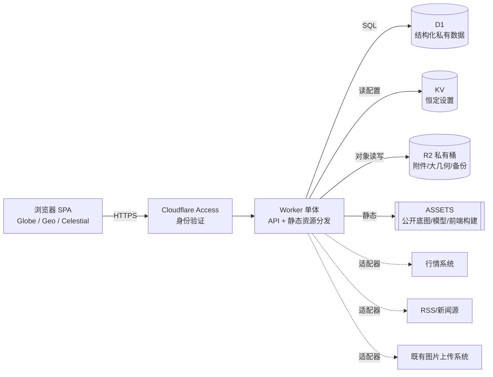
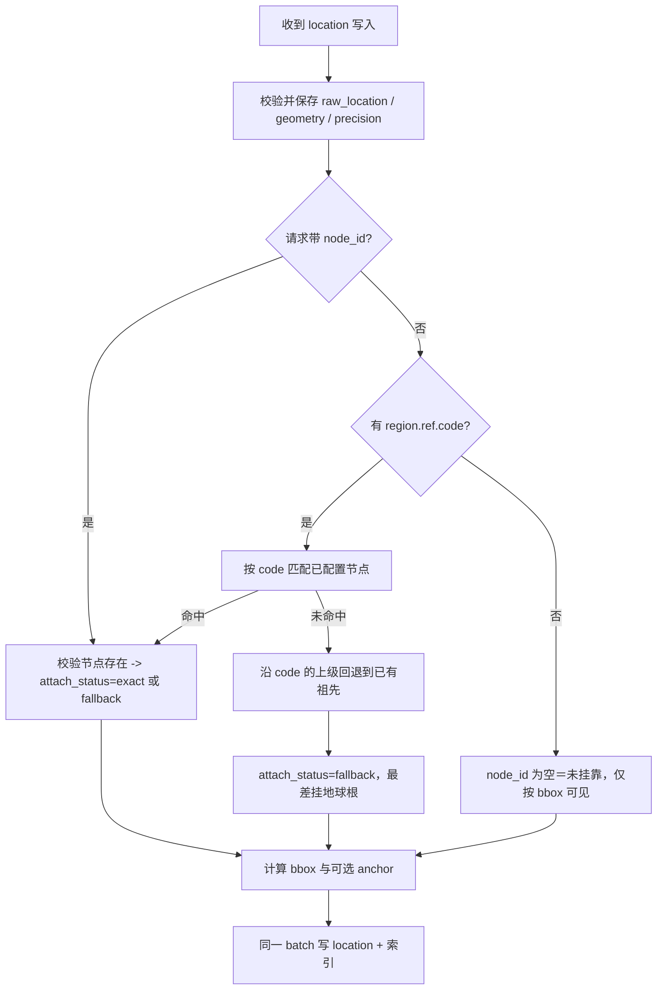

# World & City — 详细设计（Detailed Design）

> 版本：v0.1 草案　日期：2026-11-10　阶段：需求分析与详细设计（**不写代码、不写可执行 DDL**）
> 上游：[PRD v1.2](../WorldAndCity_PRD_v1.2_Spatial_Annotation_AI_Development.md)、[需求分析](01-requirements-analysis.md)
>
> ⚠️ **公开仓库**：本文只含通用设计与虚构示例，不含任何个人或私密数据。
>
> 标记说明：**【决定】** 本设计已选定；**【暂定】** 待用户确认（见 §14）；**【验证】** 需在编码前做小型验证（见 §13）。

---

## 1. 总体架构

PRD 要求"三部分最简架构、不是三个微服务"。落地为**一个 Cloudflare Worker + 一个前端单页应用 + 三类存储**。



| 层 | 职责 | 实现边界 |
|---|---|---|
| ①空间与信息数据层 | 节点、内容、位置、关系、搜索 | D1 + 服务层（Worker 内模块） |
| ②场景展示层 | Globe、Geo、Celestial 场景与面板 | 前端 SPA；3D 与 SVG 分离 |
| ③外部数据适配层 | 行情、新闻、既有图片系统 | Worker 内适配器模块；失败隔离 |

**【决定】** 不引入 Durable Objects、Queues、Cron、独立任务调度。所有外部数据"按需拉取＋边缘缓存"。

---

## 2. 环境与数据流（落实"数据不持续放本地"）

### 2.1 三种环境

| 环境 | 用途 | D1／KV／R2 | 允许的数据 |
|---|---|---|---|
| **local** | 编码、测试 | 仓库内固定开发库 `data/local/worldandcity-dev.sqlite`（**已确认入库**，见 §2.2）；测试用例另用内存库；KV／R2 用本地模拟，状态目录放临时区 | 仅 L0／L1 与虚构示例 |
| **dev**（云端） | 联调、部署演练 | 独立资源，名称带 `-dev` | 仅示例数据 |
| **prod**（云端） | 真实使用 | 独立资源，名称带 `-prod` | 真实数据（L2–L4） |

**【决定】** dev 与 prod 的资源标识、绑定名相同、实例不同；任何脚本默认指向 local，指向 prod 需显式参数且二次确认。

### 2.2 local 的数据规则

1. **【已确认 2026-11-10】本地开发库入库**：`data/local/worldandcity-dev.sqlite` 是一个由本项目自己创建的库，**允许提交到公开仓库**，用于让协作者与 AI 开箱即用。当前为空库（无表、无数据）。
   - `.gitignore` 仅对这一个路径开例外，其他 `*.sqlite`／`*.db`／备份仍一律忽略。
   - 库内**只能有 `wc_` 表**，且只能含 L0／L1 数据（迁移产生的结构、`seed/` 公开种子、`seed/demo/` 虚构示例）。
   - **严禁**把真实数据写进该文件：它一旦提交就是公开的，且 Git 历史无法靠后续提交抹除。真实数据只存在于线上 D1。
   - 不得使用其他项目的数据库文件做基础；本库是本项目新建的空库。
2. 会话启动时：按 `migrations/` 补齐表结构 → 导入 `seed/` 公开种子 → （可选）导入 `seed/demo/` 虚构示例。操作可重复执行。
3. 测试用例不直接改动该文件，而是在内存库或临时拷贝上运行，避免每次测试都产生二进制差异。
4. 该文件使用 `journal_mode=DELETE`，保证所有写入落在单一主文件，不产生 `-wal`／`-shm`（这两类仍被忽略）。`.gitattributes` 将其标为二进制，避免换行转换。
5. **不从 prod 拉取任何数据到本地**（PRD §0-13），也不做"脱敏子集"。需要复现问题时，手工构造虚构夹具放入 `seed/demo/` 或测试代码。
6. 浏览器端只持久化非私有的界面偏好（如画质档位）；内容数据缓存仅在内存，页面关闭即失。

### 2.3 本地 SQLite 的实现方式【已确认，Q1】

- 本地用 Node 内置 `node:sqlite`，由本项目**自行实现**一层与 D1 同形的薄封装（`prepare / bind / all / first / run / batch`），并按编号顺序执行迁移。
- 不引用、不复制其他项目的代码或数据文件；开发库是本项目**新建的空库**。
- 开发库入 git，因此使用 `journal_mode=DELETE`，让写入落在单一主文件。
- 本地 SQLite 与 D1 的 SQLite 版本、编译选项可能不同，涉及触发器、`json_*` 函数时先做 §13 验证（FTS5 仅为可选升级）。

---

## 3. 仓库内容规划（公开仓库边界）

### 3.1 目录

```text
worldAndcity/
├── README.md                   # 含公开仓库声明
├── docs/                       # 需求、设计、决策记录
├── migrations/                 # wc_NNNN_*.sql，表结构，无数据
├── seed/                       # 公开通用种子（L1）
│   ├── nodes.public.json       #   世界、大洲，及两条深度不同的通用示例路径（中国→陕西省→西安市→未央区；法国）
│   ├── categories.json         #   一级四类、二级起始集合
│   └── demo/                   #   虚构示例数据，id 一律 demo_ 前缀
├── config/defaults/            # 可公开的配置默认值，部署时写入 KV
├── geo/                        # 公开底图（Natural Earth 派生）+ manifest
│   └── SOURCES.md              #   来源、版本、下载时间、许可
├── src/                        # 前端
├── worker/                     # API、服务、适配器
├── scripts/                    # 开发会话、种子导入、提交守卫（设计阶段不实现）
├── tests/
├── wrangler.jsonc              # 占位符版本（真实资源 ID 不入库）
└── .gitignore
```

PRD §16.3 的 `assets/` 拆为 `geo/`（公开底图）与前端构建内的模型／贴图。不为凑结构预建空目录。

### 3.2 允许与禁止

| 路径 | 内容 | 规则 |
|---|---|---|
| `seed/**`、`config/defaults/**`、`geo/**` | JSON 数据 | 每个文件头含 `_origin: "public"` 与 `_license`（或指向 `SOURCES.md`）；缺失则守卫拒绝 |
| `seed/demo/**` | 虚构示例 | 名称明显虚构（"示例人物A"）；坐标用公开地标或随机海域点；禁止使用本人生活轨迹 |
| `data/local/worldandcity-dev.sqlite` | 本地开发库（**唯一例外**） | 守卫额外校验：只含 `wc_` 前缀的表与 `wc_d1_migrations`；文件大小 ≤ 5 MB；`wc_nodes.origin` 只能是 `seed／demo`；`wc_items.origin` 只能是 `demo`；`wc_item_locations`、`wc_item_relations`、`wc_attachments`、`wc_news_pins`、`wc_node_links` 的行必须能追溯到 `demo` 的 item 或 `seed／demo` 的节点（无归属行视为违规） |
| 其他路径 | 不得出现数据文件 | 其他 `*.sqlite *.db *.bak`、导出包、图片附件一律拒绝 |
| `wrangler.jsonc` | 配置 | 资源 ID、AUD、域名使用 `REPLACE_*` 占位；真实值放被忽略的 `wrangler.local.jsonc` 或 CI 变量 |

### 3.3 提交守卫（设计，三道防线）

1. **本地**：pre-commit 钩子扫描暂存区：禁止扩展名、数据目录白名单、敏感模式（邮箱、手机号形态、`-----BEGIN`、JWT 形态、长随机令牌形态、`CF_`/`CLOUDFLARE_` 变量赋值）。
2. ~~CI~~：已取消（2026-11-11，用户决定：项目完全本地手动管理，不使用 GitHub Actions）；需要时手动运行 `npm run guard -- --all` 与 `node --test`。
3. **平台**：开启 GitHub secret scanning 与 push protection。

误提交的处置流程写入 `docs/` 的运维说明：立即轮换凭据 → 重写历史并强制推送（必要时联系平台清理缓存）→ 记录事件。**仅提交一个删除变更不能清除历史。**

---

## 4. 存储设计

### 4.1 D1 总则

- 表前缀 `wc_`【**已确认 Q2**：线上与账户内其他项目共用**同一个 D1 库**，靠表前缀隔离】。本项目不得读写非 `wc_` 前缀的表，迁移中也不得修改它们。
- 共用同一个库意味着：Free 额度（读写行数、存储）按账户合计；`wrangler d1 migrations apply` 的迁移记录表必须独立命名（见 §4.5）。
- 主键：文本 ID。种子节点使用稳定可读 ID（如 `geo.cn`），其余用 ULID（时间有序、无需协调）。
- 时间：系统时间一律 UTC 毫秒整数。事件发生时间见 §4.2 的 `items`。
- 硬删除，无 `deleted_at`（复审 M10）；删除 item 时级联清理其位置、关系、分类、附件行（§7.7）。
- 行大小上限 2 MB；应用层限制 `body` ≤ 100 KB，内联几何 ≤ 64 KB（超出拒绝；大几何走 R2 的方案首版后置，复审 M15）。
- 一条语句绑定参数 ≤ 100：批量写入用 `batch` 发送多条单行语句，不拼接超长 `VALUES`。
- 多表原子写入统一用 `batch`（单次调用只计一次查询额度）。
- 外键启用；删除策略默认 `RESTRICT`，由服务层给出明确错误。

### 4.2 表设计

```mermaid
erDiagram
  wc_nodes ||--o{ wc_nodes : parent
  wc_nodes ||--o{ wc_item_locations : attached
  wc_items ||--o{ wc_item_locations : has
  wc_items ||--o{ wc_item_relations : from
  wc_items ||--o{ wc_item_relations : to
  wc_items ||--o{ wc_item_categories : tagged
  wc_categories ||--o{ wc_item_categories : used
  wc_items ||--o{ wc_attachments : owns
  wc_nodes ||--o{ wc_news_pins : pinned_at
  wc_items ||--o| wc_news_pins : is
  wc_nodes ||--o{ wc_node_links : has
```

#### `wc_nodes`（PRD §2、§6）

| 列 | 类型 | 说明 |
|---|---|---|
| `id` | TEXT PK | 种子节点稳定 ID；用户节点 ULID。不得含 `/` |
| `parent_id` | TEXT NULL | 根节点为空；FK 自引用，`RESTRICT` |
| `path` | TEXT | 物化路径，如 `/geo.world/geo.asia/geo.cn/`；写入后不变；有索引（见下） |
| `realm` | TEXT | `geo` ／ `celestial` |
| `kind` | TEXT | `world, continent, country, admin1, city, district, area…`（geo）；`system, planet, moon, star, galaxy…`（celestial）。不强制层数，值域由 `cfg:public` 的 `kinds` 分节校验 |
| `name` | TEXT | 展示名 |
| `name_local` | TEXT NULL | 本地语言名 |
| `code` | TEXT NULL UNIQUE | 稳定外部编码（ISO 3166 或底图数据集编码）；用于与底图 path 映射（PRD §2.3） |
| `geom_ref` | TEXT NULL | 底图 manifest 键，如 `ne:admin0:CN`；为空表示无专属几何 |
| `bbox_w/s/e/n` | REAL NULL | 经纬度包围盒；`w > e` 表示跨 180° 经线（§5.2） |
| `detail` | TEXT(JSON) | 模板变量，如地理特征、文化特色；缺失键自然隐藏（FR-N6） |
| `sort_order` | INTEGER | 同级排序 |
| `search_norm` | TEXT NULL | 名称的规范化检索列（§4.2 搜索） |
| `origin` | TEXT | `seed` ／ `user` ／ `demo`；导出时区分 |
| `created_at/updated_at` | INTEGER | |

- **不存在**任何 `is_followed / is_favorite / focus` 列（FR-N3）。
- `children_count` **不落库**，按 `parent_id` 索引实时计数；API 返回 `children: {state: "none" | "loaded" | "not_loaded", count?}`（FR-N2）。
- **【决定】** v1 不支持节点移动（改父节点）；错误挂靠时新建节点并重新挂靠位置。理由：节点一旦创建，`path` 永不改变，省去路径重建与一致性风险。
- **物化路径 `path`（复审 M1，取代闭包表）**：形如 `/geo.world/geo.asia/geo.cn/`，以 `/` 开头结尾，节点 `id` 不得含 `/`。创建节点时由服务层用父节点的 `path` 拼接，写入后不变。
  - 祖先：把 `path` 按 `/` 拆分，一次 `WHERE id IN (…)` 取出（面包屑、回退候选）。
  - 后代（含自身）：范围比较 `path >= :p AND path < :p_upper`，`:p_upper` 为 `:p` 末尾 `/`（0x2F）替换为 `0`（0x30）。不用 `LIKE`，故不受 D1 `LIKE` 50 字节限制。
  - 校验：`path` 必须等于 `父.path || id || '/'`，恢复后做一致性检查（§10.3）。

#### `wc_items`（人物、地点、组织、历史、趣闻、置顶新闻）

| 列 | 类型 | 说明 |
|---|---|---|
| `id` | TEXT PK | ULID |
| `type` | TEXT | `person, place, org, history, trivia, news`；**创建后不可变**（服务层保护） |
| `subtype` | TEXT NULL | 历史记录类型等 |
| `title` | TEXT | |
| `summary` | TEXT NULL | ≤ 200 字，写入时生成，用于各层级摘要（PRD §7.2） |
| `body` | TEXT NULL | ≤ 100 KB |
| `happened_text` | TEXT NULL | 事件发生时间原文，`YYYY`／`YYYY-MM`／`YYYY-MM-DD`／带偏移的 ISO 8601。**不被创建时间替代**（FR-L2） |
| `happened_sort` | INTEGER NULL | 上述时间换算的最早时刻，仅用于排序与范围查询 |
| `extra` | TEXT(JSON) | 类型专属：昵称、头像附件 ID（`avatar_att_id`，PRD §8.1）、新闻来源与 `published_at`、`importance`（来源未定，缺省为空，§7.4）、链接等 |
| `link_url` | TEXT NULL | 详情／管理／原文链接；写入时校验协议为 `https` 或应用内路径（PRD §7.5） |
| `source_ref` | TEXT NULL | 来源说明 |
| `search_norm` | TEXT NULL | 标题＋正文前若干字的规范化检索列（§4.2 搜索） |
| `origin` | TEXT | `user` ／ `demo`。**入库开发库中的 `wc_items` 必须全部为 `demo`**（§3.2） |
| `created_at/updated_at` | INTEGER | 无软删除（复审 M10） |

- `news` 类 item **只在置顶或手工收藏时才入库**；实时新闻不入 D1（FR-W2）。
- 外部新闻只保存标题、短摘要、来源、时间、原文链接（PRD §22.3）。

#### `wc_item_locations`（PRD §7.4，沿用既定表名）

| 列 | 说明 |
|---|---|
| `id`, `item_id` | `item_id` FK，随 item 删除而级联删除 |
| `node_id` | **可导航挂靠节点**；可空（纯坐标先不挂靠）；FK `RESTRICT` |
| `attach_status` | `exact` 命中最具体节点／`fallback` 回退到祖先或根／`pending` 歧义待确认；`node_id` 为空即未挂靠（复审 M13） |
| `role` | `primary, secondary, center, track, impact…` |
| `geometry_type` | `region, point, radius, line, polygon` 或 NULL（NULL＝仅节点绑定，用于天体节点与无空间新闻；**天体节点必须为 NULL**，§5.1） |
| `geometry` | TEXT(JSON)，≤ 64 KB；结构见 §5.1 |
| `geometry_ref` | TEXT NULL，R2 键，用于大型几何；**首版后置，列预留但不实现**（复审 M15） |
| `search_norm` | TEXT NULL，规范化的 `raw_location` 检索列 |
| `bbox_w/s/e/n` | REAL NULL，由 `geometry` 写入时**服务端计算**，客户端传入的值忽略 |
| `raw_location` | TEXT NULL，原始地名／方位文字，**永不被回退逻辑改写** |
| `precision` | `exact, approximate, area, administrative, unknown`（**来源精度**） |
| `anchor_lon/anchor_lat` | REAL NULL，展示锚点；**有值即为人工指定**。缺省时由客户端从几何或挂靠节点推导，带"位置示意"角标，**不得当作真实位置**（PRD §7.3；复审 M13 删除 `anchor_derived`） |
| `source_ref`, `verification_status` | `unverified, verified, disputed` 等，允许空 |
| `observed_at`, `valid_from`, `valid_until` | INTEGER NULL；未知则为空，不虚构 |
| `created_at/updated_at` | |

两种精度在列上分开：**来源精度 = `precision`＋`geometry_type`＋`raw_location`；挂靠精度 = `node_id`＋`attach_status`**（FR-A3）。

#### `wc_item_relations`

| 列 | 说明 |
|---|---|
| `id` PK, `from_item_id`, `to_item_id` | 均 FK `CASCADE`：删除 item 时一并删除其关系 |
| `relation_type` | `involves`：历史→非历史对象（计入 3 个名额）；`follows`：历史→历史，有方向；`related`：历史↔历史，无方向 |
| `created_at` | |

约束（详见 §4.3）：`from ≠ to`；`(from, to, relation_type)` 唯一；`related` 以 `from < to` 的规范顺序存储，避免 A→B、B→A 重复。

#### `wc_categories` 与 `wc_item_categories`

- `wc_categories`：`id, parent_id, level(1|2), key, label, sort_order, origin`。一级四类（人际关系、固定往返地址、计划地址、吃吃吃）来自 `seed/categories.json`，**不可删改层级**；二级可增删。
- `wc_item_categories`：`(item_id, category_id)` 联合主键，仅限 `person/place/org`。
- 分类定义放 D1 而非 KV：它们被外键引用，需要一致性。

#### `wc_attachments`

| 列 | 说明 |
|---|---|
| `id`, `item_id`, `sort_order` | |
| `storage` | `r2` ／ `external`（复用既有图片系统时） |
| `ref`, `thumb_ref` | R2 键或外部引用 |
| `mime`, `bytes`, `width`, `height` | 上传时校验魔数与大小（复审 M12：不存哈希） |
| `created_at` | |

- 记录里只存引用，展示用缩略图，打开详情再取原图（PRD §8.6）。

#### `wc_news_pins`

| 列 | 说明 |
|---|---|
| `node_id`, `item_id` | 联合主键；`item_id` 必须是 `type='news'` |
| `pinned_at` | |

- **【决定】置顶名额按节点计**：每个节点最多 5 条置顶（触发器保证）；满额时拒绝并返回 `E_PIN_LIMIT`，不替换（PRD §10）。
- **祖先视图（Q14 已确认）**：先显示该节点自己的置顶；名额有余再按 `pinned_at` 补入后代节点的置顶，总数仍 ≤ 5（PRD §7.2、§10 "跨层展示去重"）。详见 §7.4。

#### `wc_node_links`

`id, node_id, kind(market|detail|admin|feed), label, ref, sort_order, enabled`。保存国家级代表指数的**绑定**（FR-M1）、各类跳转链接（FR-D1），以及节点的新闻源（`kind='feed'`，`ref` 为 RSS／API 地址，复审 M3：不再单设 `wc_news_sources`）。行情数值不入库，由适配器实时读取。新闻源的选择反映个人兴趣，属于私有数据，只存 D1。

#### 搜索：`search_norm` 列（复审 M2）

- 不建独立搜索表。`wc_nodes`、`wc_items`、`wc_item_locations` 各增加一列 `search_norm`：把名称／标题／正文前若干字／`raw_location` 经应用层规范化（全半角、大小写、去标点，繁简可选）后拼接写入，与主记录同一 `batch`。
- 查询用 `search_norm LIKE '%词%'`。D1 的 `LIKE` 模式 ≤ 50 字节（约 16 个汉字），查询词超长时截断。
- 单用户数据量小，可接受全列扫描；超过约 2 万可检索行再升级为 FTS5 trigram（S1 验证可用性）。搜索不走索引属**已知例外**，并受 §4.8 读行数预算约束，必须带 `limit`。

#### `wc_meta`

`key, value`：保存 `schema_version`、`seed_version`、R2 待清理清单等运维数据。

### 4.3 约束与触发器（服务端强制）

PRD 只强制两项数量约束必须在保存端验证：**历史最多 3 个非历史对象**（§8.3）与**新闻置顶 5 条**（§10）。这两项除服务层校验外，在数据库层再设触发器防线，以抵御并发或绕过 API 的写入；其余规则由 CHECK／UNIQUE 或服务层完成，避免触发器过多（复审 M14）。D1 单库串行执行写入，触发器内的计数检查是安全的。

| 规则 | 实现 | 错误码 |
|---|---|---|
| 一条历史最多 3 个非历史对象 | `wc_item_relations` BEFORE INSERT 触发器：`relation_type='involves'` 且该 `from_item_id` 已有 ≥3 条 `involves` 时 `RAISE(ABORT)`。同一触发器校验两端类型：`involves` 的 `from` 必须是 `history`、`to` 必须不是 `history`；`follows／related` 两端均为 `history` | `E_HISTORY_OBJECT_LIMIT` ／ `E_RELATION_INVALID`（`type_mismatch`） |
| 无自关联 | `CHECK (from_item_id <> to_item_id)` | `E_RELATION_INVALID`（`self`） |
| 无重复边 | `UNIQUE (from_item_id, to_item_id, relation_type)`；`related` 另有 `from_item_id < to_item_id` 的 `CHECK` | `E_RELATION_INVALID`（`duplicate`） |
| 历史—历史不占名额 | 计数只统计 `involves` | — |
| 每节点 ≤5 条置顶 | `wc_news_pins` BEFORE INSERT 触发器 | `E_PIN_LIMIT` |
| 置顶对象必须是 `news` | 服务层校验 | `E_VALIDATION` |
| `type` 不可变 | 服务层拒绝 `PATCH` 修改 | `E_FORBIDDEN_OP` |
| 分类仅适用于 person／place／org | 服务层校验 | `E_FORBIDDEN_OP` |
| 一级分类不可变 | 服务层拒绝对 `level=1` 的写入（种子导入除外） | `E_FORBIDDEN_OP` |
| 天体位置不带几何 | 服务层校验（§5.1） | `E_FORBIDDEN_OP` |

触发器抛出的消息以错误码开头，Worker 解析后映射为统一错误响应。迁移文件包含触发器定义，本地开发库、内存测试库与线上 D1 使用同一份。【验证 S2：D1 与本地均支持触发器及 `RAISE`】

展示层防循环：关联展开由客户端逐跳进行，使用 `visited` 集合，已展开的节点不再展开（FR-L4）；服务端只返回一跳。

### 4.4 索引（只为真实查询建立）

| 查询 | 索引 |
|---|---|
| 子节点列表 | `wc_nodes(parent_id, sort_order)` |
| 子树（祖先视图） | `wc_nodes(path)`，用范围比较 `path >= :p AND path < :p_upper` |
| 视野候选 | `wc_item_locations(bbox_s, bbox_n)` ＋ 在 SQL 中再过滤经度；规模假设 ≤ 10⁵ 条，超出再评估 R*Tree 或网格索引 |
| 节点视图 | `wc_item_locations(node_id, valid_until)` |
| 某 item 的位置 | `wc_item_locations(item_id)` |
| 对象的历史 | `wc_item_relations(to_item_id, relation_type)`、`(from_item_id, relation_type)` |
| 按类型与时间 | `wc_items(type, happened_sort DESC)`；`(type, updated_at DESC)` |
| 置顶 | `wc_news_pins(node_id, pinned_at)` |

落地前对每条主要查询用 `EXPLAIN QUERY PLAN` 检查走索引（§11）。

### 4.5 迁移

- `migrations/wc_NNNN_描述.sql`，只含表结构、索引、触发器，**不含数据**。文件名带 `wc_`，避免与同库其他项目的 `0001_*.sql` 同名。
- **迁移记录表必须改名**：wrangler 默认把已执行的迁移记在 `d1_migrations` 表，按文件名判断是否已执行。同一个库里多个项目共用该表，会出现"别的项目的 0001 已执行，所以本项目 0001 被跳过"的误判。因此在 D1 绑定中设置 `migrations_table: "wc_d1_migrations"`（官方支持的自定义项），并给文件名加 `wc_` 前缀。落地前先在 dev 库用另一个项目的迁移做一次共存验证（S11）。
- 线上由 `wrangler d1 migrations apply`（用**库名**而非绑定名，官方建议，避免绑错）应用；本地开发库与内存测试库由小型迁移执行器按同一份文件顺序执行，同样记录在 `wc_d1_migrations` 表中，使本地与线上行为一致。不依赖 `PRAGMA user_version`（托管环境行为未验证）。`wc_meta` 只存 `seed_version` 等运维信息。
- 迁移必须向前兼容、幂等；破坏性变更分两步（先加后删）。
- 种子数据通过独立导入步骤写入，使用 `INSERT ... ON CONFLICT DO NOTHING／UPDATE` 实现可重复执行，并在 `wc_meta.seed_version` 记录版本。

### 4.6 KV 设计（恒定设置）

**绑定名** `CONFIG`。读多写少、可最终一致；每个键写入限每秒一次。复审 M9 后合并为 **2 个键**：

| 键 | 内容 | 来源 | 是否可公开 |
|---|---|---|---|
| `cfg:public:v1` | 单个 JSON，含 `version` 与分节：`ui`（纯观赏空闲时长、聚焦动画时长、四元素开关、密度阈值）、`visual`（色板、光照、画质档位参数、字体栈）、`templates`（各 `kind` 的详情模板与缺失字段隐藏规则）、`kinds`（节点 `kind` 值域与顺序）、`news`（排序权重、摘要长度、缓存时长） | 仓库 `config/defaults/` 各分节文件，部署时合并写入 | 是 |
| `cfg:adapters:v1` | 适配器启用状态、**端点 URL（非密钥）** | 部署时写入，**不入仓库**（端点可能暴露私有系统） | 否 |

规则：

1. **不在 KV 放**：需要强一致或有数量约束的数据（置顶、关系、分类定义）、密钥、令牌、个人内容。
2. 每个值带 `schema_version` 字段；Worker 读取时用内置默认值兜底，KV 不可用不影响基础功能。
3. 读取：`cacheTtl` 60 秒（KV 最小值 30 秒）＋同一 isolate 内内存缓存。管理端写入后有传播延迟，界面提示"配置稍后生效"（不再单列 S8 实测）。
4. 写入：只有管理端点（受鉴权）与部署脚本能写；公开默认值来自仓库 `config/defaults/`，带私有值的键只由部署脚本从私有来源写入。
5. **PRD 的固定上限（新闻 5、趣闻 2、历史关联 3）作为代码常量，不放 KV**，避免配置与触发器不一致。

### 4.7 R2 设计（文件读写）

**绑定名** `FILES`，**私有桶，不开启公开访问，不使用 `r2.dev`**。

| 前缀 | 内容 | 访问 |
|---|---|---|
| `att/{item_id}/{att_id}/orig.{ext}` | 原图 | Worker 鉴权后流式返回，`Cache-Control: private` |
| `att/{item_id}/{att_id}/thumb.webp` | 缩略图 | 同上，可较长缓存 |
| `backup/{UTC时间戳}/manifest.json` | 备份清单 | 同上，管理接口 |
| `backup/{UTC时间戳}/{table}.{page}.json` | 各表分页数据 | 同上 |

> 大型私有几何 `geo-private/` 与上传暂存 `staging/` 首版后置（复审 M15），出现真实需求再加。

设计要点：

- 缩略图在**浏览器端生成**后与原图一并上传（Worker 不做图像处理，避免引入额外服务）。
- 上传限制：单文件 ≤ 10 MB【暂定】，只接受 `image/jpeg|png|webp|gif`；校验魔数而非只信 `Content-Type`。
- 同一对象键并发写入每秒最多 1 次，键含唯一 ID，天然规避。
- 备份保留最近 5 份（Q4），超出的在新导出完成后由导出流程删除。
- 公开底图**不**放 R2，而随部署进入静态资源并版本化命名，享受边缘缓存。

### 4.8 Free 计划额度预算（Q9 已确认：Workers Free）

单人使用下，**日常读写远低于上限**，结论与用户判断一致。但 Free 有几项限制与日常用量无关，会直接影响某些功能的**实现方式**，需在设计中提前规避。数值取自 Cloudflare 官方文档（2026-10-29／30 更新），仅作设计约束参考，不做额度实测（T2）。

| 资源 | Free 限制 | 单人日常用量 | 判断 |
|---|---|---|---|
| Worker 请求 | 10 万次／天（超出返回 1027） | 每次页面浏览约 10–30 次 API，一天几百次 | 充裕 |
| D1 读行数 | 500 万行／天（账户合计） | 走索引的查询每次读几行到几百行 | 充裕；**无索引的全表扫描才危险**，见 §4.4 与 §11 |
| D1 写行数 | 10 万行／天 | 日常录入每天几十到几百行 | 充裕；索引的写入也计入 |
| D1 存储 | 5 GB（账户内所有库合计） | 文本数据预计远小于 100 MB | 充裕；附件走 R2，不进 D1 |
| KV 读 | 10 万次／天 | 配置读取有缓存，实际很少 | 充裕 |
| KV 写 | **1000 次／天**（不同键） | 仅管理端改配置 | 充裕；**不得把 KV 当计数器或会话存储** |
| R2 | 10 GB-月存储，A 类 100 万次／月，B 类 1000 万次／月 | 取决于照片数量 | 充裕；缩略图可明显减少 B 类读取 |
| 静态资源 | 每个 Worker 版本 ≤ 20,000 个文件，单文件 ≤ 25 MiB | 底图按国家拆分后文件数需控制 | 需关注 |
| D1 Time Travel | 7 天 | — | 见 §10.1 |

**需要在设计层面处理的三点：**

1. **每次请求 CPU 时间仅 10 ms（Free）**。等待网络、KV、D1、R2 的时间不计入，只算代码执行时间。风险点：导出时的 JSON 序列化；恢复时的 JSON 解析与逐行校验；大几何的边界框计算；上传图片的魔数检查。对策：
   - 导出与恢复**拆成多次请求**，由页面端循环驱动：每次只处理一页（建议 ≤ 200 行），在 `manifest` 中记录进度，可断点续传；
   - 不做 gzip 与哈希（复审 M11/M12），缩略图在浏览器端生成，Worker 只校验魔数与大小；
   - 内联几何限 64 KB，超出直接拒绝（`E_GEOMETRY_INVALID`）；`geometry_ref` 大几何在首版**后置**（复审 M15）；
   - 页大小做成常量（200 行，保守取值，不做专门实测，出问题再调）。
2. **静态资源请求不要都经过 Worker**。若配置为"所有请求先过 Worker"（`run_worker_first: true`），所有静态文件请求都会进 Worker，计入 10 万次／天及 CPU。本项目设计为**只有 `/api/*` 先过 Worker**，公开底图、模型、贴图、前端脚本由平台直接提供。页面入口的鉴权由 Cloudflare Access 在边缘完成。具体配置写法落地时查官方文档确认（不做额度实测）。
3. **单次调用对内部服务（D1、KV、R2）的子请求上限为 1000 次**。列表接口要求常数次查询并用 `batch`；导出、恢复、重绑建议、批量清除附件等批处理接口**必须分页**，不得在一次调用里循环调用数百次。

**监控**：D1 每次查询返回 `meta.rows_read / rows_written`。开发阶段在测试中断言主要查询的 `rows_read` 不超过预期上限（例如节点子列表 ≤ 子节点数 + 常数），把"误写出全表扫描"拦在合并之前。

---

## 5. 空间设计

### 5.1 坐标与几何表示

- 存储坐标统一为 **WGS84 经纬度（度）**，经度 −180…180，纬度 −90…90。投影只存在于视图层。
- `geometry` JSON 结构：

| 类型 | 结构要点 | 校验 |
|---|---|---|
| `region` | `{ref: {code?, node_id?, dataset?}, text}` | 至少给出 `ref` 或 `raw_location` 之一；**不写入坐标** |
| `point` | `{lon, lat}` | 范围合法 |
| `radius` | `{lon, lat, radius_m}` | `radius_m > 0` 且 ≤ 上限（建议 2×10⁷） |
| `line` | `{coords: [[lon,lat],…]}` | ≥ 2 点；总大小受内联 64 KB 上限约束，超出拒绝 |
| `polygon` | `{rings: [[[lon,lat],…],…]}` | 环闭合、≥ 4 点、外环＋洞；相邻点经度差 > 180 视为跨经线需拆分 |

- **服务端不做地理编码**。任何时候只保存用户（或来源）提供的坐标；"某岛国东北部"只能是 `region` ＋ 原文（PRD §0-11、§7.4.2）。
- **天体不借用地球经纬度**（PRD §7.4.2）：挂靠 `realm='celestial'` 节点的位置，`geometry_type` 必须为空，仅做节点绑定；服务层拒绝并返回 `E_FORBIDDEN_OP`（`reason=celestial_geometry`）。未来若需要天体表面坐标，须另行定义坐标基准。

### 5.2 包围盒与跨 180° 经线

- `bbox_w, bbox_s, bbox_e, bbox_n` 在写入时由服务端计算。
- 跨经线约定：`bbox_w > bbox_e` 表示区间跨越 180°。
- 视野查询：设视野为 `(w,s,e,n)`，纬度用 `bbox_s <= n AND bbox_n >= s`；经度分情形：
  - 两者均不跨：`bbox_w <= e AND bbox_e >= w`；
  - 任一跨：拆成两个区间分别比较再 `OR`。
- 对 `radius`，bbox 按半径换算纬度跨度，经度跨度乘 `1/cos(lat)`；靠近极点时取全经度。
- 【验证 S6】用太平洋跨经线台风案例确认不漏查。

### 5.3 挂靠与回退（PRD §7.3、§7.4.5）

写入流程（服务端只做确定性步骤，匹配建议在客户端完成）：



- **节点匹配建议**由客户端借助已加载的静态几何做点在面内判断，给出候选；存在多个候选时 `attach_status=pending`，由用户确认（PRD §7.3 末条）。服务端不加载全部节点几何。
- **回退链**：最具体已配置节点 → 沿 `path` 拆出的祖先 → 世界／地球根。孤立海洋点可挂地球根，仍记为 `fallback`。
- **绝不**用回退节点的中心点或 bbox 中心充当 `geometry`；锚点（人工指定或客户端推导）仅用于放图标。
- **重新挂靠**：新增节点后，`POST /nodes/{id}/rebind-suggestions` 返回"挂靠在该节点祖先、且其 `region.ref.code` 或 bbox 落入新节点范围"的位置清单。用户确认后才更新 `node_id/attach_status`；`raw_location`、`geometry`、`precision`、`item_id` 不变（FR-A4、FR-A5）。

### 5.4 时效与展示规则

- "当前"事件：`valid_until IS NULL OR valid_until > now`，且 `valid_from IS NULL OR valid_from <= now`。过期记录默认不出现在"当前"图层，可在历史视图按需查询（FR-A6）。
- `verification_status` ≠ `verified` 时地图图例显示"未核实"；预测（`role='track'` 等）使用虚线样式，与已发生事实视觉区分（PRD §7.4.6 案例 3）。
- 图形语义：`point` 实心点；`approximate` 虚线圈；`area` 半透明区域；`line` 轨迹线；无人工锚点而由客户端推导的图标带"位置示意"角标。精度不会因聚合而升级。

### 5.5 视野候选查询与聚合

- 请求参数：`bbox`、`zoom`、`at`（时间点，默认现在）、`types`、`limit`。仅查询**地球空间**（`geometry_type` 非空）的位置。
- 人物与地点（PRD §8.1）与其他内容同走此接口：有几何则按几何呈现；只绑定节点而无几何的，以其挂靠节点的区域级标记呈现，并保持"位置示意"语义。
- 服务端先用 bbox 与时效过滤，再 `GROUP BY item_id` 去重（FR-A10 多国新闻只占一个名额）。
- 超过 `limit`（默认 300）时返回**网格聚合计数**（按 zoom 决定的网格）而非全部候选，并带 `truncated: true`；客户端据此显示聚合标记，放大后再取明细。
- 响应只含摘要和几何的轻量版；完整几何在点开某条内容时随 `GET /items/{id}` 取得（`geometry_ref` 大几何首版后置，复审 M15）。

### 5.6 底图与节点的映射

- 公开底图来源【暂定 Q7】：**Natural Earth**（官方声明为公有领域）派生的 TopoJSON，先提供世界国家级（低精度）与按国家拆分的一级行政区文件。
- `geo/manifest.json`：`key → {file, level, bbox, version, license_key}`。`wc_nodes.geom_ref` 引用 `key`。
- `geo/SOURCES.md` 每个数据集除来源、版本、下载时间、许可外，增加**边界口径**一栏，记录该数据源对争议地区的表达方式（PRD §22.3），不开发额外政治立场系统。
- 文件名带内容哈希，响应 `Cache-Control: public, max-age=31536000, immutable`。
- **覆盖缺口（Q10 已确认处理方式）**：Natural Earth 并不覆盖所有国家的二级行政区（如 PRD 示例"西安市未央区""蕨市"）。处理方式：
  - **开发阶段按需补充建模数据**：需要更深层级时，把对应的通用节点与几何作为建模数据补充到 `seed/` 与 `geo/`（公开通用数据，随仓库版本管理）。
  - 补充之前，该节点没有专属几何：选中时高亮其父级多边形并显示点／圈标记，不阻塞功能。
  - 本设计不新增许可核验流程，PRD §22.3 的既有条款保持不变。
  - 提醒（沿用既有条款，非新增）：GADM 许可禁止再分发，不应放入公开仓库；OSM 衍生数据受 ODbL 约束。
- 底图、业务节点、内容标注三层保持分离：标注是独立覆盖层，不写回底图 SVG（FR-N4）。

### 5.7 PRD §7.4.6 六个案例的数据映射

| 案例 | `geometry_type` | `precision` | `node_id / attach_status` | 备注 |
|---|---|---|---|---|
| 小仓北区某街道面馆 | `region`（有可信坐标才 `point`） | `area` 或 `approximate` | 已配置最细祖先／`fallback` | 保存街道原文；不创建街道节点 |
| 太平洋台风中心 | `point` | `exact` | NULL 或世界根／`fallback` | 带 `observed_at`；不吸附到国家 |
| 台风路径与影响范围 | 同一 item 多条：`point`＋`line`＋`radius` 或 `polygon` | 各自标注 | 同上 | `role` 区分中心／轨迹／影响；预测虚线 |
| 岛国东北部疫情 | `region` | `area` | 岛国节点／`exact` 或 `fallback` | 只存引用与"东北部"原文，无坐标 |
| 法国里昂餐厅，树只到法国 | `point`（如有真实坐标） | `exact` | 法国／`fallback` | 后续新增"里昂"节点可重新挂靠 |
| 多国新闻 | 多条 `region` | 各自 | 各国节点 | 单个 item，一个名额 |

这些案例同时作为自动化验收夹具（`seed/demo/` 中以虚构名称提供，§11）。

---

## 6. API 设计

### 6.1 通用约定

- 基路径 `/api/v1`，JSON，UTF-8。
- **全部端点需鉴权**（§9）。非 `GET` 要求 `Origin` 与 `PUBLIC_ORIGIN` 一致。
- 响应缓存：含私有数据的响应一律 `Cache-Control: private`；不做服务端 `ETag`（单用户，复审 R2-M1）。
- 分页：游标式 `cursor` ＋ `limit`（默认 20，上限 100）。
- 错误格式：`{"error": {"code": "E_…", "message": "…", "details": {…}}}`。日志**不记录** `message` 中的用户正文。
- 幂等：客户端生成 ULID 作为 `id`，重复提交由主键冲突识别并返回已存在资源；不另设 `Idempotency-Key`（复审 M4）。
- 版本与请求乱序：所有 `GET` 无副作用；乱序由客户端 `AbortController` 与请求序号处理（§8.3）。

### 6.2 端点

| 分组 | 方法与路径 | 说明 | 阶段 |
|---|---|---|:---:|
| 配置 | `GET /config` | 返回 `cfg:public` 及其 `version` | P1 |
| 节点 | `GET /nodes/{id}` | 节点详情＋子节点状态 | P1 |
| | `GET /nodes/{id}/children?cursor` | 子节点分页，仅已配置节点 | P1 |
| | `GET /nodes/{id}/ancestors` | 面包屑（由 `path` 拆分，一次 `IN` 查询） | P1 |
| | `POST /nodes`、`PATCH /nodes/{id}` | 新建用户节点／改名与详情；**不支持移动** | P1 |
| | `DELETE /nodes/{id}` | 仅无子节点、无位置绑定时允许 | P1 |
| 地图 | `GET /map/annotations?bbox&zoom&at&types&limit` | 视野候选（§5.5），仅地球空间 | P2 |
| 模块面板 | `GET /nodes/{id}/life?cursor` | 子树内人物／地点／历史摘要 | P3 |
| | `GET /nodes/{id}/news` | 置顶＋外部源，≤5 条，去重 | P3 |
| | `GET /nodes/{id}/trivia` | 子树内趣闻候选（最多 10 条，客户端随机取 2） | P3 |
| | `GET /nodes/{id}/markets` | 绑定的指数摘要（适配器），失败返回 `status:"unavailable"`，HTTP 仍 200 | P3 |
| 内容 | `POST /items`、`GET /items/{id}`、`PATCH /items/{id}`、`DELETE /items/{id}` | 硬删除（§7.7） | P3 |
| | `PUT /items/{id}/locations/{loc_id}`、`DELETE …` | 位置写入（§5.3） | P2 |
| | `POST /items/{id}/relations`、`DELETE /relations/{id}` | 关系；触发器兜底（§4.3） | P3 |
| | `GET /items/{id}/related` | 直接关联（仅一跳，双向）；多跳展开由客户端逐跳点击，带 visited 防环（复审 R2-M2） | P3 |
| | `GET /items/lookup?q&type&from&to&node&object&cursor` | 关联时的条件检索（分页，FR-L5） | P3 |
| 分类 | `GET /categories`、`POST /categories`（仅二级）、`PUT /items/{id}/categories` | | P3 |
| 附件 | `POST /items/{id}/attachments`、`GET /attachments/{id}/(thumb\|orig)`、`DELETE …` | 流式读写 R2 | P3 |
| 置顶 | `POST /nodes/{id}/news-pins`、`DELETE /nodes/{id}/news-pins/{item_id}` | 第 6 条返回 `E_PIN_LIMIT` | P3 |
| 搜索 | `GET /search?q&types&limit&cursor` | 统一搜索，结果含 `node_id` 供直达 | P2 |
| 直达 | `GET /nodes/{id}/context` | 一次返回目标节点、祖先链、必要邻近信息，供跨层跳转（PRD §15.2） | P2 |
| 管理 | `PUT /admin/config/{key}` | `key` 仅限 `public`（`cfg:public:v1`）；写 KV，校验 schema，递增版本。`cfg:adapters:v1` 只由部署脚本写 | P1 |
| | `POST /admin/export`、`GET /admin/backups`、`GET /admin/backups/{id}`、`POST /admin/restore?dry_run=1` | §10 | P5 |
| 重绑 | `POST /nodes/{id}/rebind-suggestions` | §5.3 | P2 |

### 6.3 错误码

精简为 13 个（复审 M8）：`E_AUTH`、`E_FORBIDDEN_ORIGIN`、`E_VALIDATION`、`E_NOT_FOUND`、`E_CONFLICT`、`E_HISTORY_OBJECT_LIMIT`、`E_PIN_LIMIT`、`E_RELATION_INVALID`、`E_GEOMETRY_INVALID`、`E_NODE_IN_USE`、`E_UPLOAD_INVALID`、`E_UPSTREAM_UNAVAILABLE`、`E_FORBIDDEN_OP`。

细分原因放在 `details.reason`：`E_RELATION_INVALID` 含 `self / duplicate / type_mismatch`；`E_NODE_IN_USE` 含 `has_children / has_locations`；`E_UPLOAD_INVALID` 含 `too_large / bad_type`；`E_FORBIDDEN_OP` 含 `item_type_immutable / category_locked / category_type / celestial_geometry`。

### 6.4 外部适配器接口

| 适配器 | 输入 | 输出 | 失败策略 |
|---|---|---|---|
| Markets | 节点绑定的 `ref` | `{label, value, change_pct, state, as_of, link}` | 超时 3 秒，返回 `unavailable`，不阻塞面板 |
| News | 节点的源列表 | 标题、短摘要、来源、`published_at`、链接 | 每源独立超时，部分成功即可；缓存时长取 `cfg:public` 的 `news` 分节 |
| Attachments（既有系统） | 引用 | 缩略图／原图地址 | 接口协议待用户提供（Q8）；当前只定义 `storage='external'` 的占位 |

适配器相关密钥放 Worker secret。适配器不写 D1，除非用户显式"置顶／收藏"。

---

## 7. 业务规则落地

### 7.1 祖先摘要与去重（PRD §7.2）

- 节点视图查询：位置绑定在**该节点或其后代**（`path` 前缀范围比较）的 item，以 `item_id` 去重。
- 向下不扩散：绑定在国家的内容不会出现在其城市视图，除非另绑城市。
- 每个模块独立查询、独立限额；摘要用 `summary`，正文展开时才取。

### 7.2 历史记录对象限制

- 创建历史时，对象选择器最多 3 个；服务端在 `batch` 中先插 `involves`，由触发器兜底。
- 地理节点、位置、时间、标题、正文不占名额；"餐厅"若作为独立 `place` item 被关联，则计入（PRD §7.4.8）。

### 7.3 记录关联

- 创建 `follows`（有向）与 `related`（无向）；删除关系不删除记录。
- 发现关联时双向查询：对 `follows`，返回"前序／后继"；对 `related`，两端皆可见。

### 7.4 新闻

- 候选＝该节点的置顶 ∪ 各启用源（`wc_node_links.kind='feed'`）的外部条目（经去重）。
- 祖先视图（Q14 已确认）：先显示本节点自己的置顶；名额有余再按 `pinned_at` 补入后代节点的置顶；仍总数 ≤ 5，超出部分提示"另有 n 条置顶"。名额**按节点计**，拒绝第 6 条的规则不变。
- 排序：置顶永远在前；其余按
  `score = w_i·importance + w_f·freshness(published_at) + w_g·geo_relevance(depth_gap)`，权重在 `cfg:public` 的 `news` 分节，默认值待原型调参。**重要程度来源未定（PRD §20）：缺省为 0，即只按新鲜度与相关度排序**，不伪造评分。
- 总数 ≤ 5；置顶满 5 时不展示外部条目。
- 去重键：规范化 URL；无 URL 则 `标题+来源+日期` 哈希。
- 置顶后，D1 保存合规摘要，原源下线仍可展示（PRD §10、§22.3）。

### 7.5 趣闻

- 服务端返回子树内候选 ≤ 10 条；客户端以 `(node_id, 会话号)` 为种子稳定抽取 ≤ 2 条，停留期间不重抽，进入新节点才重抽（FR-T1）。

### 7.6 搜索

- 范围：节点名、item 标题／正文、位置 `raw_location`（含人物与地点，PRD §12）。
- 实现：各表的 `search_norm` 列（§4.2）+ `LIKE`，结果限量分页；FTS5 仅在数据量超过约 2 万可检索行时升级。S1 本地结果（[`decisions/0001`](decisions/0001-s1-search.md)）：FTS5 trigram 对 2 字中文词零结果，故升级后 ≤2 字的查询仍须走 `LIKE`，trigram 只加速 ≥3 字查询；规范化须在绑定参数前去除 `%`、`_`，避免用户输入变成通配符。D1 侧限制未验证（[`decisions/0003`](decisions/0003-wrangler-blocked-steps.md) B4）。
- 结果项：`{kind, id, title, snippet, node_id, path_text}`，点击后调用 `GET /nodes/{id}/context` 直达（FR-S2）。

### 7.7 删除

- **硬删除**，界面二次确认（复审 M10：无软删除）。后悔药是 D1 Time Travel（7 天）与应用级导出。
- 删除 item 时同一流程内级联删除其位置、关系、分类、附件行与置顶；R2 对象删除失败时记入 `wc_meta` 的待清理清单，下次管理操作重试。

### 7.8 展示限额不影响存储（PRD §13；FR-V1）

- 新闻 5、趣闻 2 及各面板条数只作用于**展示查询**的 `LIMIT`，不限制库内保存数量。
- 同一区域标注过多时由 §5.5 聚合；人物与地点同样走该聚合。

---

## 8. 前端设计

> **2026-11-10 范围调整**（[决定 0004](decisions/0004-visual-deferred.md)）：视觉效果（§8.2 地球仪与展开、§8.8 四元素与聚焦动画、§8.6 的 3D 降级、§8.7 的 3D 帧率）后置到里程碑 M8，现阶段以带“视觉占位”标注的静态内容替代。本章的契约（场景接口、`waveState`、`projection` 策略、内部数据始终为经纬度）**保持不变**，M8 再落成代码。

### 8.1 模块与场景管理

```text
src/
  app/            路由、全局状态、配置读取
  scenes/         globe | geo | celestial   统一接口：init / activate / deactivate / dispose
  components/     导航树、详情面板、搜索、四元素装饰、标注图例
  features/       life、markets、news、trivia、annotation-editor
  data/           API 客户端、缓存、请求去重与取消、几何加载
  utils/
```

- **场景接口**：`activate()` 开始渲染循环；`deactivate()` 停止循环并释放可重建的 GPU 资源（纹理、缓冲区）；`dispose()` 彻底清理（PRD §15.3、§18.4）。
- 同一时刻只有一个 3D 场景处于活动状态；页面不可见（`visibilitychange`）时暂停。
- Three.js 与场景代码按需懒加载；首屏先出壳、导航与加载提示。

### 8.2 地球仪与展开（P0）

- 海洋、玻璃、水晶、帆船、仪轨的参数在 `cfg:public` 的 `visual` 分节；"默认水晶海洋＋木帆船"作为可替换的**内部展品组件**，对外只暴露 `mount(scene)`／`update(waveState)`（PRD §4.3）。
- 小船姿态由**同一个 `waveState`** 驱动（PRD §4.2）。
- 球→平面：以投影插值（正射→Mollweide 之类）为基础，叠加镜头、透明度、仪轨退让；最终投影**未锁定**，设计保留 `projection` 为可替换策略，P0 原型阶段用 2–3 个候选比较后再定【验证 S3】。
- 内部数据始终为经纬度；投影只在渲染层。

### 8.3 加载、缓存与竞态（PRD §15）

| 机制 | 设计 |
|---|---|
| 分阶段 | ①壳与配置 → ②地球仪 → ③进入地图时并行：几何、节点导航、基础介绍 → ④异步：标注候选与四模块 → ⑤展开时：全文、关联、精细几何、图片 |
| 取消与乱序 | 每次导航生成递增的 `navSeq`；请求携带 `AbortController`；响应落地前核对 `navSeq`，不一致丢弃 |
| 缓存 | 内存 LRU：节点（含子节点页）、几何文件、面板摘要；同键并发请求合并（in-flight 去重）；按需重新请求 |
| 预取 | 空闲时仅预取：当前节点的父节点与已展开子节点的**元数据**；不预取全部几何、图片、历史 |
| 跨层 | 直接调用 `context`，只取目标节点及祖先链元数据与目标几何 |
| 模块失败 | 各模块独立状态：`loading / empty / error / unavailable`；一个失败不影响其他（PRD §15.2） |
| 无数据与未加载 | UI 明确区分"确无子节点"与"尚未加载" |

### 8.4 状态与深链接（PRD §14.1）

- URL 形如 `/n/{node_id}?s=geo&c={lon},{lat}&z={zoom}&p={panel}`。
- URL 只含节点 ID、场景、镜头、面板；不含内容文本与个人名称。
- 返回时先读 URL，再合并内存中的轻量状态（导航展开、滚动位置）。无服务端会话。

### 8.5 标注渲染

- 独立覆盖层（SVG 或 Canvas），随地图投影同步更新；不修改行政区 path。
- 聚合：按当前 zoom 对服务端返回的候选做网格聚合；聚合标记只显示计数，不显示精度；放大后展开。
- 与约 1 秒聚焦动画并存：聚焦期间暂存标注更新，动画结束统一提交，避免打断（PRD §7.4.7）。

### 8.6 降级与可访问性

- 画质档位 `high / mid / low`：由设备能力（像素比、核数、内存提示）与首次短时帧率探测决定，用户可手动覆盖；`low` 降低折射采样、波浪精度、粒子数量，保留交互。
- 偏好 `prefers-reduced-motion` 时关闭强动画，默认进入静态展示。
- 移动端：隐藏四角装饰，保留导航与地图。

### 8.7 性能目标（**待实测校准的目标值，非已验证事实**）

| 指标 | 初定目标 |
|---|---|
| 首屏壳（不含 3D 库）压缩后 | ≤ 150 KB |
| 地球仪可见并可交互 | 中档移动设备、4G 网络下 ≤ 3 秒 |
| 节点详情 API | P95 ≤ 300 ms（边缘到 D1） |
| 视野标注查询 | P95 ≤ 400 ms，返回 ≤ 300 条 |
| 活动 3D 场景帧率 | 桌面 ≥ 50 fps；`low` 档 ≥ 30 fps |

### 8.8 纯观赏模式与四元素装饰（PRD §3.4、§5.2；FR-V2）

- 手动开关 + 无操作自动进入；空闲时长放配置（`cfg:public` 的 `ui.idleSeconds`），默认值由原型阶段确定，**不在设计中伪造确定值**（PRD §20）。
- 进入后收起信息面板与次要标记，保留艺术场景；任意输入立即恢复。地球仪与天体优先支持，地图仅隐藏次要面板。
- 风、土、水、火四角装饰只在桌面地图场景显示，不遮挡边界、控件与文字；移动端隐藏。素材为静态资源，实现方式留待原型。
- `prefers-reduced-motion` 时默认关闭自动进入与强动画。

### 8.9 详情／管理跳转与"定位回空间"（PRD §7.5；FR-D1）

- 每条内容的"打开"动作取 `link_url`（`https` 或应用内路径）；节点级跳转取 `wc_node_links`。外链不编造：没有链接则不显示按钮。
- 每条内容在详情中提供"在地图上定位"：调用 `GET /nodes/{id}/context`（有 `node_id` 时）或按几何 bbox 定位，使从外部页面返回后可回到其空间位置。

---

## 9. 安全与隐私

### 9.1 身份验证与授权

- 整站置于 **Cloudflare Access** 之后，Worker 内用变量 `ACCESS_TEAM_DOMAIN`、`ACCESS_AUD` 校验令牌【暂定 Q3】。
- Worker **再次校验**请求头中的 Access JWT（签名、`aud`、`iss`、过期），并比对 `email` 与 Worker secret `OWNER_EMAIL`。不仅依赖边缘规则，以防 `workers.dev` 等入口绕过。
- 关闭 `workers.dev` 与预览域名的公开访问，或让它们同样要求 Access。
- 本地开发的认证绕过仅在 `ENVIRONMENT=local` 且来源为回环地址时生效；Worker 在 `dev/prod` 环境忽略该开关。

### 9.2 传输与存储

- 仅 HTTPS；设置 HSTS、`X-Content-Type-Options: nosniff`、`Referrer-Policy: no-referrer`。
- CSP：默认仅同源；脚本、样式、图片、连接目标逐项白名单；因包含 WebGL，需允许 `blob:` 与 `data:` 图像按需开放。
- D1／R2／KV 的静态加密由平台提供；本项目不自建加密层（含导出包，复审 M5）。

### 9.3 隐私措施

| 面 | 措施 |
|---|---|
| 日志 | 仅记录请求 ID、路由模板、状态码、耗时；不记录正文、查询词、坐标、人名、令牌 |
| 错误信息 | 对外统一格式，不回显堆栈与 SQL |
| 外链 | `link_url` 仅允许 `https` 或应用内路径；外开使用 `rel="noopener noreferrer"` |
| 上传 | 缩略图由浏览器重绘生成（自然不含 EXIF）；**原图原样保存，可能含 EXIF／GPS**，仅存私有桶、经鉴权读取。若将来需要分享原图，须先自行剥离（复审 M6） |
| 缓存 | 私有数据不进共享缓存；仅公开底图使用 `public` |
| 访问频率 | 不做应用层速率限制：单用户且在 Access 之后；用 KV 计数会消耗 Free 的写入额度（复审 M7） |
| 第三方脚本 | 不引入第三方分析与广告脚本 |
| 示例数据 | 严禁真实人名、住址、坐标；使用明显虚构数据 |

### 9.4 密钥管理

- 使用 `wrangler secret`；不放 `vars`；不入仓库；不放 KV。
- 轮换：每个适配器密钥独立，泄露时可单独撤销。
- 变更记录写入 `docs/` 运维说明，**不记录密钥值**。

---

## 10. 备份、导出与恢复（PRD §14.2）

> 复审 M10–M12 后已简化：无软删除、无 `ndjson.gz`、无哈希。

### 10.1 三层恢复手段

| 层 | 手段 | 说明 |
|---|---|---|
| 1 | D1 Time Travel | 平台能力，常开、无额外费用；**当前为 Free 计划，只能回到 7 天内**（付费 30 天）。恢复是整库覆盖，会连带影响同库其他项目的表，因此只用于"刚刚改错了"的紧急回退；恢复前先记下返回用的书签。**也是误删（硬删除）的后悔药** |
| 2 | 应用级导出 | 自有格式，只含 `wc_` 表，可单独恢复而不影响同库其他项目；写入 R2 `backup/`。**Free 只有 7 天 Time Travel，这一层是更长期的主要备份** |
| 3 | 异地副本 | 用户手动下载导出包保存到私有位置；**不建议长期留在开发机**（C6） |

> **备份不得提交到本公开仓库**：导出包含真实私有数据，属于 PRD §0-12 禁止项。若习惯用 git 保存备份，必须使用**另一个私有仓库**，且该私有仓库不得与本仓库混用同一远端。

### 10.2 导出格式

- `manifest.json`：`format_version, schema_version, exported_at, tables{name→rows}, external_dependencies[]`。
- 数据：每表一组分页 JSON 文件（`{table}.{page}.json`），按主键键集分页读取。**Free 计划每次请求 CPU 仅 10 ms**（§4.8），导出由页面端循环驱动，每次请求只处理一页（初定 ≤ 200 行）并把进度写入 `manifest`，可断点续传；页大小为常量，保守取值。不做 gzip 与哈希（复审 M11）。
- 包含：节点（`origin='user'` 全量，种子节点只记引用）、items、位置、关系、分类、附件元数据（含 R2 键）、置顶、节点链接（含新闻源）、`cfg:public` 快照（排除私有键）。
- **不含**：附件原文件与外部行情、新闻全文；`external_dependencies` 明确列出这些依赖（PRD §14.2 第三条）。附件原文件可选择"附带导出"，作为另一个对象前缀。
- 单用户无并发写入，不做跨表快照；清单记录 `exported_at`。

### 10.3 恢复

1. **dry-run（默认）**：校验 `format_version`、行数、外键完整性、枚举合法、3 对象上限、置顶上限、无自环与重复边、`type` 与关系类型匹配。输出报告，不写库。
2. 恢复前自动生成一份"恢复前备份"。
3. 目标必须是空库或显式 `replace` 模式；种子节点按稳定 ID 合并。
4. 写入顺序：节点（按 `path` 长度由浅入深）→ 分类 → items → 位置 → 关系 → 附件元数据 → 置顶 → 节点链接。同样由页面端分页驱动，每次请求一小批；注意 Free 的 D1 写入上限为 10 万行／天，索引的写入也计入，超大恢复需分多天或先估算写入行数。
5. 恢复范围**只限 `wc_` 表**，不触碰同库其他项目的表。
6. 结束后运行完整性检查（外键、`path` 一致性）。

---

## 11. 测试与验收设计

### 11.1 测试层次

| 层 | 内容 | 环境 |
|---|---|---|
| 约束测试 | 触发器与 CHECK：第 4 个对象被拒；自环、重复边被拒；第 6 条置顶被拒。服务层校验：`type` 不可变、一级分类锁定、天体位置不带几何 | 本地内存库 |
| 服务测试 | 回退链、重绑不改原始数据、时效过滤、去重、跨经线查询 | 同上 |
| API 契约 | 状态码、错误码、分页、鉴权失败 | 本地 Worker 模拟 |
| 查询计划 | 主要查询 `EXPLAIN QUERY PLAN` 不出现全表扫描 | 本地＋dev |
| 隐私守卫 | 守卫脚本对"放入违禁文件／违禁内容"的夹具能拒绝；日志脱敏测试 | CI |
| 一致性 | 本地与 dev 对同一夹具得到相同结果（防 SQLite 版本差异） | CI |
| 视觉／性能 | 手动清单＋帧率与包体积检查 | 真机 |

### 11.2 验收映射

- PRD §18 全部条目与 §22.4 六条门槛。
- 新增：

| 编号 | 检查 |
|---|---|
| A-NFR1 | 仓库 `git ls-files` 中无数据库文件、导出包、图片、`.env`；守卫通过 |
| A-NFR2 | 会话结束后项目目录与默认状态目录中无新增 SQLite／KV／R2 状态；入库开发库的变更仅限迁移与种子产生的差异 |
| A-NFR3 | 未携带有效 Access 令牌的任何请求（含静态资源之外的所有 API）返回 401／403 |
| A-NFR4 | R2 桶无公开访问；对象 URL 无法匿名读取 |
| A-NFR5 | KV 中无密钥与个人内容 |
| A-NFR6 | 导出→在空 dev 库恢复→导出，两次清单中各表行数一致 |
| A-NFR7 | 种子文件缺少 `_origin/_license` 头时 CI 失败 |
| A-NFR8 | 日志抽样无正文、坐标、令牌 |

---

## 12. 需求追溯矩阵

| 需求 | 设计章节 |
|---|---|
| FR-N1–N3、N5 | §4.2 `wc_nodes`（含 `path`）；§6.2 节点端点 |
| FR-N4 | §5.6、§8.5 |
| FR-N6 | §4.6 `cfg:public` 的 templates 分节；§4.2 `detail` |
| FR-N7 | §4.2（`realm`）、§8.1 |
| FR-A1–A5 | §5.1、§5.3、§4.2 `wc_item_locations` |
| FR-A6 | §5.4 |
| FR-A7、A8 | §5.2、§5.5、§8.5 |
| FR-A9 | 首版后置（复审 M15）：§4.2 仅预留 `geometry_ref` 列，内联几何上限见 §5.1 |
| FR-A10 | §5.7、§11 |
| FR-L1 | §4.2 `wc_categories` |
| FR-L2 | §4.2 `happened_text/happened_sort` |
| FR-L3、L4 | §4.3、§7.2、§7.3 |
| FR-L5 | §6.2 `items/lookup` |
| FR-L6 | §4.2 `wc_attachments`、§4.7、§6.4 |
| FR-L7 | §7.1 |
| FR-M1 | §4.2 `wc_node_links`、§6.4 |
| FR-W1–W3 | §4.2 `wc_news_pins`、§4.3、§7.4 |
| FR-T1 | §7.5 |
| FR-S1、S2 | §4.2 `search_norm` 列、§7.6 |
| FR-D1 | §4.2 `link_url`／`wc_node_links`、§6.2 `context`、§8.9 |
| FR-V1 | §7.8 |
| FR-V2 | §8.8 |
| FR-P1 | §8.4 |
| FR-B1 | §10 |
| FR-F1 | §8.3 |
| NFR-1 | §3.3、§9.3 |
| NFR-2 | §2.2 |
| NFR-3、4 | §9.1、§4.7 |
| NFR-5 | §4.6 |
| NFR-6 | §4.1、§4.2 |
| NFR-7 | §4.5 |
| NFR-8 | §9.3 |
| NFR-9 | §3.2、§5.6 |
| NFR-10 | §10.1 |
| NFR-11 | §4.8 |
| NFR-12 | §4.1、§4.5、§10.3 |

---

## 13. 编码前的小型验证（Spike）

在进入编码阶段前，用最小实验消除下列不确定性。每项产出一页结论写入 `docs/decisions/`。S8（KV 传播延迟）与 S9（EXIF）已在合规复审中取消（M16），编号保留不重排。

| # | 验证内容 | 通过标准 | 失败时的备选 |
|---|---|---|---|
| S1 | `search_norm` ＋ `LIKE` 基线的中文检索效果与 D1 的 `LIKE` 50 字节限制；顺带验证 FTS5 trigram 是否可用（仅作为将来升级的选项） | 能检索 2 字词与短句；明确升级阈值 | 前缀索引或缩短查询词 |
| S2 | 触发器与 `RAISE(ABORT)` 在 D1 与本地行为一致，错误消息可被 Worker 解析 | 第 4 个对象、第 6 条置顶被拒，消息含错误码 | 改为单条 `INSERT … SELECT … WHERE count<N` 并检查 `changes` |
| S3 | 球→平面投影插值的视觉效果与移动端帧率 | 达到 §8.7 目标 | 降级为遮罩＋镜头过渡的组合 |
| S4 | `wrangler dev` 将本地状态指向临时目录并在退出后清理 | 项目目录无残留 | 在会话脚本中显式清理 |
| S5 | Natural Earth 一级行政区文件体积与简化后的视觉质量 | 单国文件 ≤ 数百 KB | 提高简化阈值或按层级分档 |
| S6 | 跨 180° 经线的 bbox 查询 | 台风案例不漏查 | 将几何拆为两段存储 |
| S7 | Worker 接收 10 MB 图片并写入 R2（在 M5 实现附件时顺带验证，不单列） | 成功且内存可控 | 缩小上限或使用分片 |
| S8 | ~~KV 传播延迟~~ 已取消 | — | 界面提示"配置稍后生效"即可 |
| S9 | ~~EXIF 重绘~~ 已取消 | — | 原图保留 EXIF，文档注明 |
| S10 | ~~页大小实测~~ 已取消（里程碑 T2） | — | 页大小取常量 200，保守取值，出问题再调 |
| S11 | 与同库其他项目的迁移共存：自定义 `migrations_table` ＋ `wc_` 文件名后，各自 `apply` 互不跳过、互不报错 | 本项目迁移与一个用默认记录表的模拟项目迁移，在同一 dev 库上都能完整执行 | 仍冲突时改用手动迁移执行器，统一记入 `wc_` 前缀的记录表 |
| S12 | ~~静态请求不过 Worker 的实测~~ 已取消（里程碑 T2） | — | 按设计只让 `/api/*` 先过 Worker；配置写法落地时查官方文档 |

---

## 14. 未决事项（Q11、Q12 已随最简化取消）

| # | 问题 | 本设计采用的暂定处理 |
|---|---|---|
| Q1 | 本地开发库如何获得？ | **已确认**：本项目用 `node:sqlite` 新建空库并入库 |
| Q2 | 是否与其他项目共用同一个 D1？表前缀？ | **已确认**：线上共用同一个库，前缀 `wc_`；迁移记录表独立命名（§4.5） |
| Q3 | 整站置于 Cloudflare Access 之后？ | 是 |
| Q4 | 备份保留份数与落点 | R2 `backup/`，最近 5 份（数据量小，不需要更多） |
| Q5 | 开发是否可连接云端 dev 资源 | 可以；严禁连接 prod |
| Q6 | FTS5 trigram 不可用时退回 `LIKE` | 接受 |
| Q7 | 底图首选 Natural Earth | 是；行政区稳定编码待选 |
| Q8 | 既有图片上传系统的接口 | 仅预留 `storage='external'` |
| Q9 | Cloudflare 账户计划（Free／Paid） | **已确认：Free**。用户判断单人使用基本不触及上限；设计按 Free 额度做预算与规避，见 §4.8 |
| Q10 | 二级及更深行政区的几何来源与展示策略 | **已确认**：开发阶段按需补充建模数据；补充前高亮父级并显示标记；不新增许可核验流程（§5.6） |
| Q11 | ~~上传原图是否重绘剥离 EXIF~~ | **取消**（M6）：原图保留 EXIF，仅缩略图由浏览器生成 |
| Q12 | ~~导出包是否口令加密~~ | **取消**（M5） |
| Q13 | 用户节点的"导出时区分"策略：种子节点按引用，用户节点全量 | 采用 |
| Q14 | 新闻置顶的祖先汇总规则 | **已确认**：名额按节点计；祖先视图自己的置顶优先，再补入后代置顶，总数 ≤ 5 |
| Q15 | 是否需要"对象—对象"关系 | **已确认**：只考虑对象与"我"的关系（由一级分类"人际关系"表达），不维护关系网；`wc_item_relations` 仅用于历史记录 |

---

## 15. 下一步（仍属设计阶段）

0. ✅ 已完成合规复审：[`04-compliance-review.md`](04-compliance-review.md)（第一轮：偏离 D1–D8、遗漏 O1–O10、最简化 M1–M18；第二轮：文字不一致 R2-D1–D8、最简化 R2-M1–M2），处置已同步到本文。
1. 用户评审本设计与 §14 未决项（Q1、Q2、Q9、Q10、Q14、Q15 及开发库入库均已确认）。
2. ✅ 已完成：P0–P5 拆成里程碑，见 [`03-milestones.md`](03-milestones.md)，含每个里程碑的范围、验收、数据合规检查点，以及 S1–S12 的排期（S8、S9、S10、S12 已取消）。
3. ✅ 里程碑待决事项 T1–T5 已答复，见 [`03-milestones.md`](03-milestones.md) §7。
4. **何时进入编码由用户指定**（T5）；在此之前不写代码。
