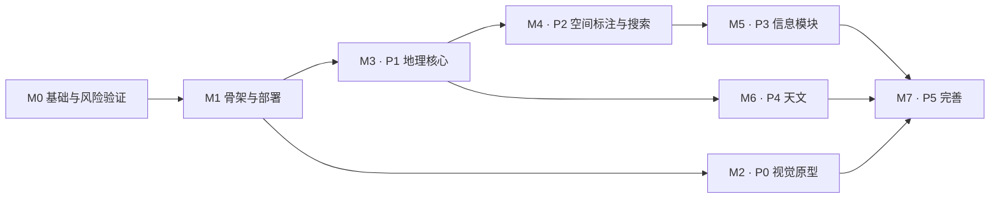

# World & City — 里程碑与验证排期

> 版本：v0.1 草案　日期：2026-11-10　阶段：设计（**不写代码**）
> 上游：[PRD §17–§18](../WorldAndCity_PRD_v1.2_Spatial_Annotation_AI_Development.md)、[需求分析](01-requirements-analysis.md)、[详细设计](02-detailed-design.md)
>
> ⚠️ **公开仓库**：每个里程碑的数据只能是通用／示例数据。真实数据只进线上 D1／R2。

本文把 PRD 的 P0–P5 拆成可验收的里程碑，并把详细设计 §13 的小验证（S1–S12，其中 S8、S9、S10、S12 已取消）排到最早需要它们的位置。

---

## 1. 排期原则

1. **先消除风险，再投入实现**：影响架构的验证（D1 行为、迁移共存、CPU 预算）排在 M0，早于任何业务代码。
2. **每个里程碑都能独立演示和验收**，并带"数据合规检查点"。
3. **PRD 的阶段顺序保持**（P0 视觉 → P1 地理 → P2 空间 → P3 信息 → P4 天文 → P5 完善），仅在 P0 之前插入 M0 基础，M1 建立线上 dev 环境以验证鉴权与绑定；**不单独做 Free 额度验证**（T2），设计已按 Free 约束保守取值。
4. **不预建空目录或空组件**（PRD §16.3）。
5. 估算用相对规模 S／M／L（小／中／大），**不承诺具体日期**，因为没有历史速度数据可依据。

---

## 2. 总览

| 里程碑 | 对应 PRD | 规模 | 主要交付 | 依赖 |
|---|---|:---:|---|---|
| M0 基础与风险验证 | — | M | 迁移执行器、提交守卫、S1/S2/S4/S11 结论 | 无 |
| M1 骨架与部署 | — | M | Worker＋前端壳、Access 鉴权、D1/KV/R2 绑定、dev 环境 | M0 |
| M2 视觉原型 | P0 | L | 玻璃地球仪、海浪与帆船、仪轨、球→平面转场 | M1（壳）；S3 |
| M3 地理核心 | P1 | L | 节点树、底图、聚焦、导航、详情模板 | M1；S5 |
| M4 空间标注与搜索 | P2 | L | 五种几何、精度回退、视野查询、搜索、跨层直达 | M3；S6 |
| M5 信息模块 | P3 | L | 生活对象、历史关联、新闻、趣闻、市场 | M4；S7（实现附件时顺带验证） |
| M6 天文 | P4 | M | 宇宙系场景、稀疏天体树 | M3（节点机制） |
| M7 完善 | P5 | M | 纯观赏、状态恢复、备份恢复、设备适配 | M2、M5、M6 |

M2 与 M3 可并行（视觉与数据互不依赖）；M6 只依赖节点机制，可在 M4／M5 之间插入。

---

## 3. 验证（Spike）排期

| # | 验证内容 | 排入 | 阻塞什么 | 结论落点 |
|---|---|:---:|---|---|
| S2 | 触发器与 `RAISE(ABORT)` 在 D1 与本地一致 | **M0** | 3 对象上限、5 条置顶的实现方式（§4.3） | `docs/decisions/` |
| S11 | 与同库其他项目的迁移共存（自定义迁移记录表） | **M0** | 同库共用能否成立（§4.5） | 同上 |
| S1 | `search_norm`＋`LIKE` 基线与 D1 的 `LIKE` 限制；顺带验证 FTS5 trigram | **M0** | 搜索方案（§7.6） | 同上 |
| S4 | 本地模拟状态目录可控 | **M0** | 开发规范（§2.2） | 同上 |
| ~~S10~~ | 10 ms CPU 下导出／恢复的页大小 | 已取消（T2） | — | — |
| ~~S12~~ | 仅 `/api/*` 先过 Worker，静态直出 | 已取消（T2） | — | — |
| S3 | 球→平面投影与移动端帧率 | M2 | 转场实现（§8.2） | 同上 |
| S5 | Natural Earth 一级行政区体积与质量 | M3 | 底图拆分策略（§5.6） | 同上 |
| S6 | 跨 180° 经线的 bbox 查询 | M4 | 台风案例（§5.2） | 同上 |
| S7 | Worker 接收 10 MB 图片写入 R2（实现附件时顺带验证，不单列） | M5 | 上传方案（§4.7） | 同上 |
| ~~S8~~ | KV 配置传播延迟实测 | 已取消（合规复审 M16） | — | — |
| ~~S9~~ | 浏览器端重绘剥离 EXIF | 已取消（合规复审 M6、M16） | — | — |

**排期理由**：S2、S11、S1 失败会改变数据库设计，必须最先做。S10、S12 随 T2 取消：页大小取保守常量，只让 `/api/*` 先过 Worker，均按设计默认实现。

**每项验证的做法**：写一页结论到 `docs/decisions/NNNN-标题.md`，包含"问题、做法、结果、决定、备选"。验证用的临时代码不进入主干（或放入 `spikes/` 且不被构建引用）。

---

## 4. 里程碑详述

每个里程碑列出：范围、涉及表／端点、验收、数据合规检查点、退出条件。

### M0 基础与风险验证（规模 M）

**范围**
- 迁移执行器（本地）：按 `migrations/wc_NNNN_*.sql` 顺序执行，记入 `wc_d1_migrations`（§4.5）。
- 提交守卫：本地钩子＋CI 的第一版（§3.3），含对 `data/local/worldandcity-dev.sqlite` 的专项检查。
- 最小种子与迁移 0001（`wc_meta`、`wc_nodes`，含 `path` 列），仅为跑通验证。
- S1、S2、S4、S11 的结论。

**验收**
- 空库→迁移→种子可重复执行，结果一致（幂等）。
- 守卫能拒绝：放入 `.env`、其他路径的 `.sqlite`、含 JWT 形态字符串的文件、缺少 `_origin` 头的种子；放行：正常文档与合规种子。
- 四项验证均有结论文档。

**数据合规检查点**
- 守卫通过；开发库只含 `wc_` 表与迁移记录表。

**退出条件**
- 若 S2 失败，设计 §4.3 改用"单条 `INSERT … SELECT … WHERE count<N`"方案并更新文档；若 S11 失败，改用统一的手动迁移执行器。两种情形都应在进入 M1 前确定。

### M1 骨架与部署（规模 M）

**范围**
- Worker：路由骨架、统一错误格式、请求 ID、日志脱敏（§9.3）。
- 鉴权：Cloudflare Access 令牌校验、`OWNER_EMAIL` 比对、关闭 `workers.dev` 入口（§9.1）。
- 绑定：D1（共用库）、KV `CONFIG`、R2 `FILES`；dev 环境资源（`-dev` 命名）。
- 配置读取：`GET /config`，KV 兜底默认值（§4.6）。
- 前端壳：空白页＋加载提示＋画质档位探测占位。
- 不做 Free 额度验证（T2）。

**验收**
- 未携带有效令牌访问任何端点返回 401／403（A-NFR3）。
- R2 桶匿名访问被拒（A-NFR4）。
- 日志抽样无正文、坐标、令牌（A-NFR8）。
- 静态资源配置为只有 `/api/*` 先过 Worker（按设计配置，不做额度实测）。

**数据合规检查点**
- `wrangler.jsonc` 只含 `REPLACE_*` 占位；真实资源 ID、AUD、邮箱不在仓库。

**退出条件**
- dev 环境可部署，D1／KV／R2 三项资源均可读写（不验证额度，T2）。

### M2 视觉原型 · P0（规模 L）

**范围**
- 玻璃地球仪、约 1/3 高水晶海洋、木帆船、多个仪轨（PRD §4）。
- 海浪状态驱动船的姿态（同一 `waveState`）。
- 球→平面转场与可替换投影策略（S3 比较 2–3 个候选）。
- 场景接口 `init/activate/deactivate/dispose`；非活动场景暂停。
- 画质档位 `high/mid/low`；`prefers-reduced-motion`。
- 纯观赏模式的开关占位。

**验收**（PRD §18.1 前四项＋§18.4 第二项）
- 视觉特征可见、自转持续、海浪偶发翻涌、船随浪。
- 点击后有连续展平过程并可返回。
- 退出 3D 场景后无持续高负载绘制。
- 中档移动设备达到设计 §8.7 的目标值（实测并记录实际数字）。

**数据合规检查点**
- 贴图与模型来源、许可记录在 `geo/SOURCES.md` 或 `assets` 清单；无第三方受限素材。

### M3 地理核心 · P1（规模 L）

**范围**
- 迁移：`wc_nodes`（含 `path`）、`wc_categories`（定义）、`wc_node_links`。
- 种子（T3）：世界、大洲，以及两条深度不同的**通用**示例路径：中国→陕西省→西安市→未央区（深路径），法国（止于国家，对应稀疏树与里昂案例）。路径只表达层级深度，**不记录任何关注／不关注标记**。
- 底图：Natural Earth 派生的国家级与一级行政区 TopoJSON，带 `manifest`（S5）。
- 端点：`/nodes/{id}`、`/children`、`/ancestors`、`POST/PATCH/DELETE /nodes`。
- 前端：左上层级导航、右侧 SVG 地图、约 1 秒聚焦与高亮、详情模板（缺失字段隐藏）。
- 开发阶段按需补充建模数据（Q10）。

**验收**（PRD §18.1 第 5–6 项、§18.2 前两项）
- 一条分支止于国家、另一条深入到区，导航都正常；无子节点不显示展开。
- API 区分"确无子节点"与"尚未加载"。
- 数据库无任何关注状态类字段。
- 底图完整度不受业务节点稀疏性影响。
- 主要查询的 `rows_read` 不超出预期（§4.8 监控）。

**数据合规检查点**
- `seed/nodes.public.json` 带 `_origin/_license`；节点名称均为公开地理名称；**不含任何个人关注偏好**。

### M4 空间标注与搜索 · P2（规模 L）

**范围**
- 迁移：`wc_items`、`wc_item_locations`（各含 `search_norm` 列）。
- 天体节点的位置不得带几何（设计 §5.1）；人物／地点同走视野候选接口。
- 五种几何的校验、bbox 计算、挂靠与回退、重绑建议（§5）。
- 端点：`/map/annotations`、`/items/.../locations`、`/search`、`/nodes/{id}/context`、`rebind-suggestions`。
- 前端：标注覆盖层、聚合／展开、图例与精度样式、搜索框与跨层直达。
- S6 结论。

**验收**（PRD §7.4.6 六案例、§18.2、§22.4）
- 面馆／太平洋台风／岛国东北部疫情三类位置同时出现在同一地图，样式区分精度。
- 法国／里昂案例：节点只到法国，原文与坐标保留，新增里昂节点后可重绑且 `item_id`、`raw_location`、`geometry` 不变。
- 跨国新闻只占一个内容名额。
- 台风中心／路径／影响范围同属一个 item，预测为虚线。
- 跨 180° 经线的查询不漏。
- 快速连续缩放只请求当前视野候选，旧响应不覆盖新场景。
- 过期事件默认不显示为"当前"。

**数据合规检查点**
- 六个案例的夹具放在 `seed/demo/`，全部使用虚构名称与公开海域坐标。

### M5 信息模块 · P3（规模 L）

**范围**
- 迁移：`wc_item_relations`＋触发器、`wc_item_categories`、`wc_attachments`、`wc_news_pins`。新闻源存于 `wc_node_links`（`kind='feed'`）。
- 生活对象与历史：分类、3 对象上限、历史间关联、关联检索（分页）。
- 附件：R2 上传、浏览器端缩略图、懒加载；S7。
- 详情／管理跳转与"在地图上定位"（FR-D1）；展示限额不影响存储（FR-V1）。
- 新闻（置顶＋RSS 适配器）、趣闻（稳定随机）、市场摘要（适配器，失败隔离）。本阶段只定展示结构并预留适配器接口（T4）；新闻 mock 参照 Google News RSS 的 RSS 2.0 条目结构（`title／link／pubDate／source／description`），数据全部虚构；具体订阅未定，不写入仓库。

**验收**（PRD §18.3）
- 第 4 个对象被拒并有明确提示；自环、重复边被拒；删除关联不删记录。
- 第 6 条置顶被拒，不替换已有置顶。
- 新闻 ≤ 5、趣闻 ≤ 2 且停留期间不闪烁。
- 行情／新闻接口失败时，地图与其他面板仍可用。
- 所有模块可打开详情／管理链接。

**数据合规检查点**
- 示例人物、地点、历史全部虚构；图片仅使用无版权风险的占位图；外部新闻只存标题＋短摘要＋来源＋链接。

### M6 天文 · P4（规模 M）

**范围**
- 宇宙系场景、稀疏天体节点（`realm='celestial'`）、艺术化尺度。
- 与地球仪的视觉衔接：靠近地球时收束深空元素。

**验收**（PRD §18.1 第 4 项、§6）
- 视觉边界成立；沿用同一套导航与搜索；真实数值带单位与可靠性说明。

**数据合规检查点**
- 天文属性数据注明来源。

### M7 完善 · P5（规模 M）

**范围**
- 纯观赏模式、浏览状态恢复（URL 深链接）、移动端与低性能降级。
- 备份：分页 JSON 导出到 R2、dry-run 恢复、恢复前自动备份（§10）。
- 纯观赏的空闲自动进入与四元素装饰（设计 §8.8，FR-V2）。
- 运维说明：误提交处置、密钥轮换。

**验收**（PRD §18.4 末三项、§18 其余未覆盖项）
- 导出→在空 dev 库恢复→再次导出，各表行数一致（A-NFR6）。
- 返回页面可恢复节点与主要浏览状态。
- 导出包明确列出外部依赖。

**数据合规检查点**
- 全仓库扫描：无数据库文件（除唯一例外）、导出包、图片附件、密钥；`git log` 抽查无敏感文件曾被提交。

---

## 5. 贯穿所有里程碑的检查清单

每个里程碑合并前逐项确认：

- [ ] 守卫通过（本地钩子与 CI）。
- [ ] 开发库 `data/local/worldandcity-dev.sqlite` 仅含 `wc_` 表与通用／示例数据。
- [ ] 新增的种子／配置默认值带 `_origin` 与 `_license`。
- [ ] 日志与错误响应不含正文、坐标、令牌。
- [ ] 新增查询已用 `EXPLAIN QUERY PLAN` 检查，且 `rows_read` 在预期内。
- [ ] 批处理接口分页（页大小取保守常量）。
- [ ] 需求追溯矩阵（设计 §12）更新。
- [ ] 若有新的外部数据源：来源、版本、许可已登记。

---

## 6. 风险与应对（排期视角）

| 风险 | 影响的里程碑 | 应对 |
|---|---|---|
| S2 或 S11 失败，需要改数据库方案 | M0→M5 | M0 就做完；失败时只改设计文档，尚无代码返工 |
| Free 的 10 ms CPU 对某些接口不够 | M1、M5、M7 | 分页与拆请求，页大小取保守常量；必要时把计算移到浏览器端 |
| 球→平面转场的移动端性能不达标 | M2 | S3 比较多个候选；保留"遮罩＋镜头过渡"的降级方案 |
| 二级以下行政区几何缺失 | M3、M4 | 按 Q10：开发阶段补建模数据；补充前用父级高亮＋标记 |
| 外部新闻／行情接口协议未确定 | M5 | 适配器接口先行，用虚构桩数据开发；新闻后续拟用 Google News RSS，具体订阅未定；行情接口未定，仅预留 |
| 既有图片上传系统接口未知（Q8） | M5 | 只实现 `storage='r2'`；`external` 仅预留字段 |
| 合规复审（`04-compliance-review.md`）两轮共削减 20 项过度设计 | 全部 | 设计文档已同步；如用户推翻某项，只改设计文档 |

---

## 7. 待决事项答复（2026-11-10）

| # | 问题 | 答复 |
|---|---|---|
| T1 | M2（视觉）与 M3（地理）是否并行？ | 无异议，并行 |
| T2 | 是否把线上部署提前以验证 Free 额度？ | **不需要验证 Free 额度**。S10、S12 取消；M1 仍建立 dev 环境验证鉴权与绑定 |
| T3 | 首批通用节点范围 | 以 中国→陕西省→西安市→未央区（深路径）与 法国（止于国家）为基础例子；"关注／不关注"是用户的个人偏好，**不写入仓库**，仓库里只体现层级深度差异 |
| T4 | 市场与新闻适配器接口 | 本组只定展示结构并预留接口；新闻后续拟用 Google News RSS，mock 参照其条目结构；具体订阅未定 |
| T5 | 进入编码阶段的触发条件 | **由用户指定后再开始开发**；在此之前不写代码 |
